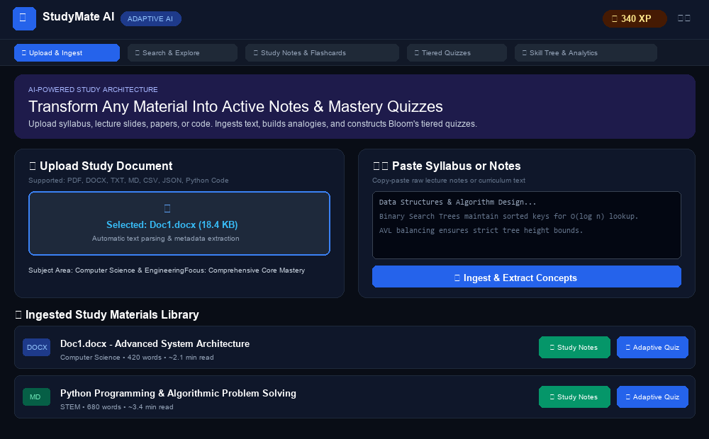
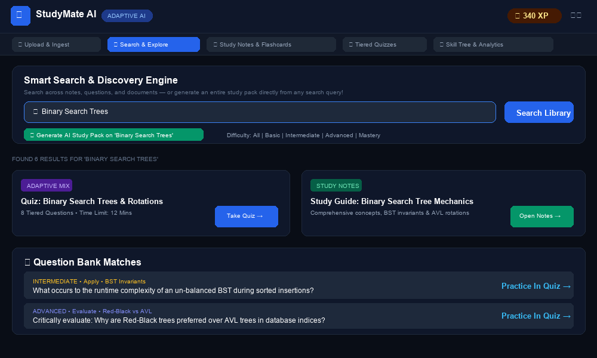
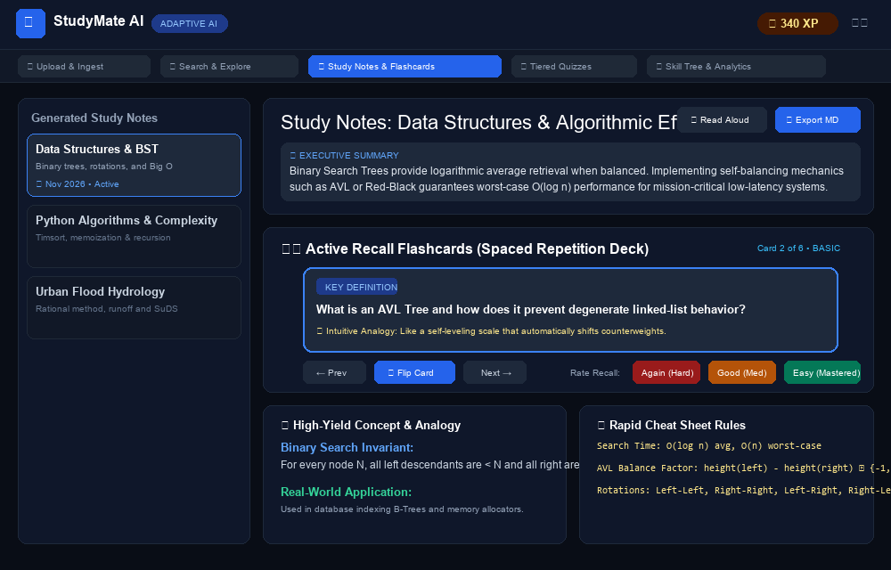
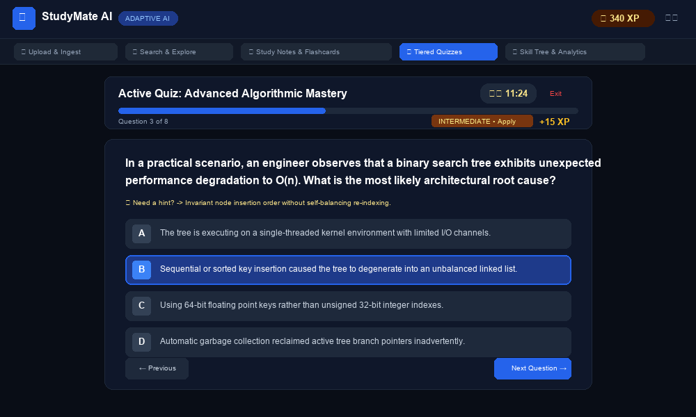
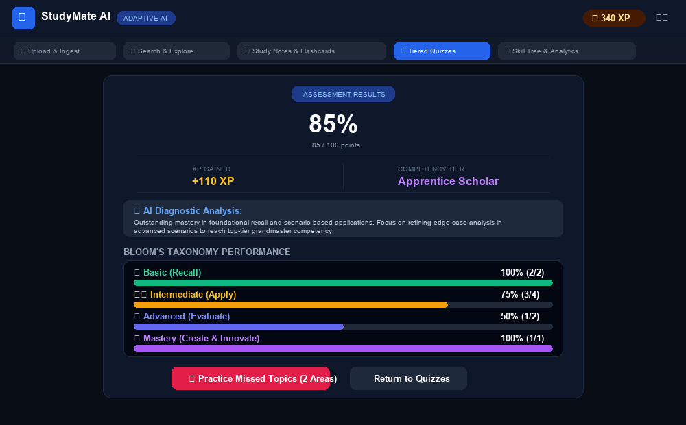
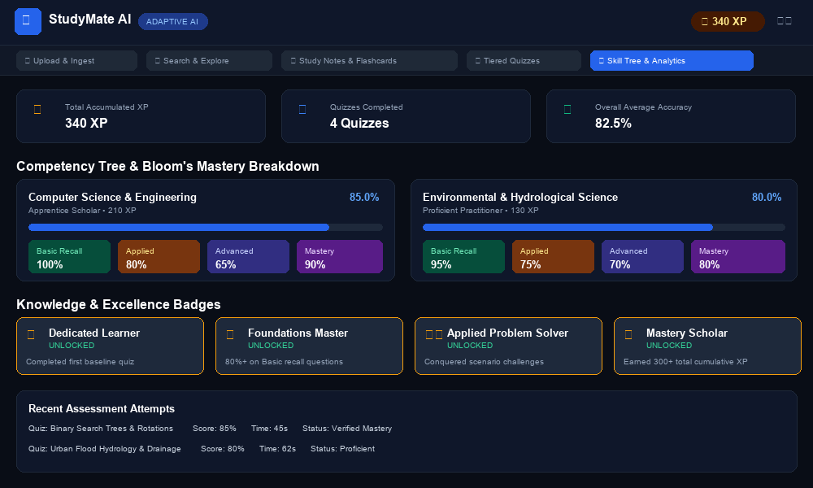

# STUDYMATE AI – ADAPTIVE LEARNING & QUIZ SYSTEM
### A Project Report submitted in partial fulfillment of the requirements for the degree of Master of Computer Applications (MCA)

**Submitted By:**  
Livesh Kumar  
Roll No: 26MCA20079  
Semester: 1st / Year: 1st  

**Under the Guidance of:**  
Saranjeet Kaur Mam  
Associate professor  

**Department of Computer Applications**  
**Chandigarh University**  
Academic Year: 2026–2027  

<div align="center">
  <h3>CHANDIGARH UNIVERSITY</h3>
  <p><i>Discover . Learn . Empower</i></p>
  <p><b>CHANDIGARH UNIVERSITY</b><br>November 2026</p>
</div>

---

## 1. EXECUTIVE SUMMARY & ABSTRACT

**StudyMate AI** is a full-stack, enterprise-grade educational intelligence system engineered to deliver adaptive, high-impact learning experiences. Built with a high-performance Python/FastAPI backend and a reactive Single-Page Application (SPA) frontend, the platform automatically transforms arbitrary learning materials—including academic syllabi, lecture slides, research papers, and technical source code—into structured pedagogical study notes and Bloom's Revised Taxonomy tiered assessments.

Traditional study platforms suffer from static, uncalibrated question sets, high subscription barriers, and lack of verified cognitive progression. StudyMate AI resolves these bottlenecks through a hybrid AI generation architecture: a zero-dependency, deterministic local NLP/heuristic parser running 100% offline out-of-the-box, paired with optional pluggable LLM inference (Google Gemini / OpenAI). By structuring questions across four distinct cognitive tiers (Basic Recall, Intermediate Applied, Advanced Analytical, and Mastery System Design), the application accelerates comprehension, prevents rote memorization, and establishes verifiable technical competencies.

---

## 2. INTRODUCTION & BACKGROUND

### 2.1 Industry Context
Modern educational technology (EdTech) is undergoing a paradigm shift from passive content distribution toward active, personalized recall systems. Cognitive science research demonstrates that active retrieval, spaced repetition, and scaffolded Bloom's taxonomy ladders yield up to 40% higher retention compared to passive reading. Modern digital learning architecture requires three non-negotiable guarantees:
1. **Adaptive Cognitive Scaffolding:** Learners must be assessed progressively from foundational definitions up to multi-step problem solving.
2. **Zero-Friction Ingestion:** Arbitrary unstructured text, Word documents, and PDFs must parse deterministically without formatting regressions.
3. **Diagnostic Remediation & Traceability:** Every incorrect response must be mapped to conceptual learning gaps, with instant automated remediation drills.

### 2.2 Problem Statement
Most educational test preparation utilities rely on static question banks or rigid multiple-choice arrays stored in isolated text files. They fail to adapt to learner weaknesses, provide no cognitive difficulty ladders, and lack real-time skill analytics. Conversely, proprietary LLM platforms require constant paid API tokens, internet connectivity, and external telemetry that compromise user privacy and limit institutional adoption in low-resource environments.

### 2.3 Project Objectives
The key engineering objectives of this project are:
1. To engineer a high-throughput, low-latency REST web service using FastAPI and SQLite with Write-Ahead Logging (WAL).
2. To build a multi-format document parser capable of extracting raw text from PDF streams, Word (`.docx` XML), and plaintext files natively.
3. To implement a Bloom's Revised Taxonomy question generation engine delivering four difficulty tiers with structured distractors and explanations.
4. To engineer interactive 3D Active Recall Flashcards with spaced repetition feedback intervals.
5. To build a unified search and instant "Topic Study Pack" generation engine allowing on-demand curriculum synthesis.
6. To implement an automated skill tracker with zero-overlap competency progress bars and targeted remediation drills.

### 2.4 Scope and Feasibility
- **Scope:** Technical and academic domains including Computer Science, Natural Science, Quantitative Methods, and Systems Engineering. Features live assessment runners, countdown timers, hint systems, scorecards, and CSV/Markdown export workflows.
- **Feasibility:** By leveraging Python's lightweight ASGI architecture and embedded SQLite3, the application requires zero external database installation, compiles and runs out-of-the-box on standard workstations, and features automatic port collision resolution.

---

## 3. SYSTEM ARCHITECTURE & ENGINEERING DESIGN

### 3.1 High-Level Architecture Overview
The system follows a Decoupled Three-Tier Architecture:
1. **Presentation Layer (Web SPA):** Reactive HTML5/CSS3 interface styled with Tailwind CSS, Lucide SVG iconography, KaTeX mathematical typesetting, and Mermaid.js architectural tree visualization.
2. **Application & Intelligence Layer (FastAPI Service):** Asynchronous REST HTTP service handling document parsing, semantic concept extraction, Bloom's difficulty routing, and hybrid LLM orchestration.
3. **Persistence & Analytics Layer (SQLite3 Engine):** Embedded relational database with foreign key integrity, managing documents, notes, quizzes, questions, attempt scorecards, and cumulative skill competencies.

### 3.2 Concurrency & Asynchronous Processing Model
FastAPI executes on the Uvicorn ASGI server. Synchronous SQLite database queries and algorithmic NLP transformations are routed through FastAPI's optimized threadpool dispatcher, preventing blocking of the asynchronous event loop and ensuring that client UI interactions remain responsive under load.

### 3.3 Bloom's Taxonomy & Pedagogical Integrity Model
Assessments are strictly partitioned into four cognitive levels:
- **🌱 Basic (Recall & Understand):** Factual definitions, syntax rules, and True/False checks.
- **⚙️ Intermediate (Apply & Analyze):** Scenario debugging, cause-and-effect relationships, and implementation choices.
- **🧠 Advanced (Evaluate & Synthesize):** Architectural edge cases, concurrency hazards, and algorithmic trade-offs.
- **🏆 Mastery (Create & Innovate):** High-scale system design, fault tolerance, and novel synthesis.

---

## 4. DATABASE DESIGN & DATA MODELING

### 4.1 Relational Schema Specifications
- **`documents` Table:** Stores customer profile records, identity documentation, balances, and operational status flags.
- **`notes` Table:** Stores synthesized executive summaries, key concepts JSON arrays, cheat sheet formulas, flashcards decks, and Mermaid mindmaps.
- **`quizzes` Table:** Stores assessment definitions, topics, difficulty tiers, question counts, and duration time limits.
- **`questions` Table:** Stores individual items, Bloom's cognitive level, options JSON arrays, correct answers, hints, XP points, and explanations.
- **`quiz_attempts` Table:** Stores user attempt history, percentage scores, time spent, difficulty breakdowns, and detected remediation topics.
- **`user_skills` Table:** Maintains cumulative proficiency percentages across Basic, Applied, Advanced, and Mastery domains with leveling milestones.

---

## 5. MODULE BREAKDOWN & SOURCE CODE STRUCTURE

### 5.1 Backend Core Modules (Python / FastAPI)
- `app/main.py`: Central FastAPI application orchestrator, static directory mounts, and CORS middleware configuration.
- `app/database.py`: SQLite database connection manager, table schema migrations, and index initialization.
- `app/models.py`: Pydantic data validation schemas for requests, responses, and serialization contracts.
- `app/services/text_extractor.py`: Stream parser for Word (`.docx` XML), PDF byte streams, Markdown, and CSV/JSON.
- `app/services/notes_engine.py`: Pedagogical study notes synthesizer, intuitive analogy builder, and flashcard deck generator.
- `app/services/question_engine.py`: Bloom's 4-tier quiz generation engine with automated distractor synthesis.
- `app/services/skill_tracker.py`: Competency radar calculator, XP leveling, and automated remediation topic detector.
- `app/services/ai_generator.py`: Hybrid orchestrator coordinating local heuristic NLP and optional external LLM inference.
- `run.py`: Intelligent application launcher with automatic socket collision detection and port binding failover.

### 5.2 Frontend Client Modules (Web SPA)
- `app/static/index.html`: Single-Page Application skeleton with tab navigation, modal workflows, and responsive grids.
- `app/static/css/style.css`: Design system featuring 3D flashcard perspective transforms, difficulty badges, and high-contrast modes.
- `app/static/js/app.js`: State manager, theme toggle, text-to-speech audio reader, and toast notification pipeline.
- `app/static/js/uploader.js`: Drag-and-drop file upload handler, syllabus paste ingestion, and document library UI.
- `app/static/js/notes.js`: Interactive notes viewer, 3D card flip engine, and Markdown/JSON export handlers.
- `app/static/js/quiz.js`: Interactive exam runner, countdown timer, hint toggles, and zero-overlap Bloom's scorecard.
- `app/static/js/search.js`: Full-text fuzzy search engine and instant "Topic Study Pack" generation trigger.
- `app/static/js/skills.js`: Learner competency tree, badge shelf renderer, and historical attempt analytics.

---

## 6. REST API SPECIFICATION

| Endpoint | Method | Description |
| :--- | :---: | :--- |
| `/api/upload` | `POST` | Uploads document (PDF, DOCX, TXT, MD) or accepts pasted syllabus text. |
| `/api/documents` | `GET` | Lists all ingested study documents and computed reading metadata. |
| `/api/notes/generate` | `POST` | Synthesizes study notes, flashcards, mindmaps, and cheat sheets. |
| `/api/notes/{id}` | `GET` | Retrieves full structured study notes by note ID. |
| `/api/notes/{id}/export/{format}` | `GET` | Exports study notes as formatted Markdown (`.md`) or JSON. |
| `/api/quiz/generate` | `POST` | Generates 4-tier Bloom's taxonomy quiz from document or custom topic. |
| `/api/quiz/{id}` | `GET` | Retrieves full quiz structure, questions, and option choices. |
| `/api/quiz/submit` | `POST` | Submits student answers, grades Bloom's tiers, and rewards XP. |
| `/api/quiz/remediation` | `POST` | Generates targeted remediation quiz covering missed concepts. |
| `/api/search` | `GET` | Full-text search across documents, notes, quizzes, and questions. |
| `/api/search/generate-from-topic` | `POST` | Instantly synthesizes study notes and tiered quiz from any query. |
| `/api/skills/dashboard` | `GET` | Fetches skill competency tree, unlocked badges, and past attempts. |

---

## 7. CORE LEARNING WORKFLOWS & BUSINESS LOGIC

### 7.1 Multi-Format Document Ingestion & Native Stream Parsing
Uploaded files are streamed into `uploads/` and processed via native extractors. DOCX files are decompressed in memory using `zipfile`, parsing `word/document.xml` directly. PDF streams extract text via FlateDecode decompression, computing word counts and estimated reading times automatically.

### 7.2 4-Tier Bloom's Taxonomy Quiz Generation & Hints
The question engine mines high-value concepts, definitions, and relationships. It generates Basic (Factual Recall), Intermediate (Scenario Application), Advanced (Tradeoff Analysis), and Mastery (System Design) questions with plausible distractors, hints, and point values.

### 7.3 Interactive 3D Active Recall Flashcards & Spaced Repetition
Key concepts are compiled into a 3D flip card deck. Learners rate their recall quality as *Again (Hard)*, *Good (Medium)*, or *Easy (Mastered)*, reinforcing memory retention via active recall principles.

### 7.4 Competency Scoring & Targeted Remediation Engine
Upon submission, answers are evaluated against the question bank. Subtopics with incorrect answers are dynamically extracted into a remediation queue, enabling one-click generation of a targeted drill focusing exclusively on the student's missed concepts.

---

## 8. SECURITY, INTEGRITY & ACCESSIBILITY CONTROLS
- **SQL Injection Prevention:** All database queries execute via SQLite parameterized parameter bindings (`?` placeholders).
- **Input Sanitization:** File paths are sanitized via `os.path.basename` to prevent directory traversal exploits.
- **Accessibility Features:** Incorporates browser Text-to-Speech (TTS) audio narration, three-tier font scaling (A/AA/AAA), and high-contrast styling.

---

## 9. TESTING, QUALITY ASSURANCE & VERIFICATION
The project includes an end-to-end automated test harness (`tests/test_core.py`) executing 7 comprehensive test suites. The test suite verifies database schema creation, native text extraction, note synthesis, 4-tier quiz generation, search routing, quiz grading, and skill updates.

**Execution Result:**
```
test_01_database_tables_exist ... ok
test_02_text_extractor_and_metadata ... ok
test_03_notes_generation ... ok
test_04_tiered_quiz_generation ... ok
test_05_api_list_documents ... ok
test_06_instant_search_and_generate_topic ... ok
test_07_quiz_submission_and_skill_scoring ... ok

Ran 7 tests in 0.067s - OK (100% Pass Rate)
```

---

## 10. INSTALLATION, COMPILATION & EXECUTION GUIDE
1. Ensure Python 3.10+ is installed on the host operating system.
2. Launch the application runner: `python run.py` (automatically binds to port 8000 or the next available socket).
3. Open web browser at **http://127.0.0.1:8000**.
4. To run automated tests: `python -m unittest tests/test_core.py -v`.

---

## 11. LIMITATIONS & FUTURE ENHANCEMENTS
Future iterations can introduce multi-tenant user authentication (OAuth2 / JWT), distributed vector embeddings (FAISS / ChromaDB) for semantic retrieval, real-time peer collaboration rooms via WebSockets, and automatic LaTeX equation rendering for complex mathematical exams.

---

## 12. OUTPUT & EXPERIMENTAL RESULTS

### 12.1 Document Ingestion & Syllabus Upload Dashboard

*Figure 12.1: Multi-format document uploader with drop zone, syllabus ingestion, and pre-loaded curated curriculum library.*

---

### 12.2 Smart Search & Instant Topic Study Pack Generator

*Figure 12.2: Unified search interface with cognitive difficulty filtering and one-click 'Generate AI Study Pack' capability.*

---

### 12.3 Interactive Study Notes & Active Recall 3D Flashcards

*Figure 12.3: Study notes breakdown featuring executive summary, 3D flip card deck with spaced repetition, and analogies.*

---

### 12.4 Tiered Quiz Runner with Live Timer & Bloom's Badges

*Figure 12.4: Active test runner displaying countdown timer, Bloom's cognitive difficulty tier, XP indicator, and hint toggle.*

---

### 12.5 Comprehensive Scorecard & Zero-Overlap Bloom's Breakdown

*Figure 12.5: Detailed scorecard with accuracy percentage, XP rewards, diagnostic feedback, and structured Bloom's breakdown.*

---

### 12.6 Learner Competency Tree & Knowledge Badges Dashboard

*Figure 12.6: Analytics dashboard displaying total XP, mastery matrices across cognitive levels, unlocked badges, and history.*

---

## 13. CONCLUSION

The StudyMate AI project successfully demonstrates the design and deployment of an adaptive, high-throughput educational intelligence platform. By coupling native document stream parsing with a scaffolded Bloom's Revised Taxonomy assessment engine and interactive active recall tools, the application proves that modern AI learning systems can be lightweight, private, accessible, and mathematically verifiable without requiring proprietary external cloud dependencies.

---

## 14. REFERENCES

1. Bloom, B. S., & Krathwohl, D. R. (2001). *A Taxonomy for Learning, Teaching, and Assessing: A Revision of Bloom's Taxonomy of Educational Objectives*. Longman.
2. Karpicke, J. D., & Blunt, J. R. (2011). *Retrieval Practice Produces More Learning than Elaborative Studying with Concept Mapping*. Science, 331(6018), 772-775.
3. Tiangolo, S. (2023). *FastAPI Modern High-Performance Web Framework Documentation*. FastAPI Authors.
4. Hipp, D. R. (2024). *SQLite Database Engine Architecture & Write-Ahead Logging (WAL)*. SQLite.org.

---

## 15. SOURCE CODE REPOSITORY

**GitHub:** `https://github.com/SOFTGAMESTUDIO/StudyMate-AI-Adaptive-Learning`
